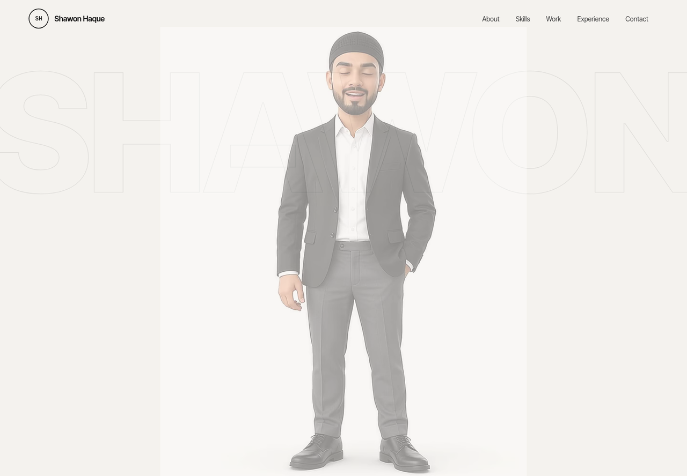

# Shawon Haque — Portfolio

**Live site: [shawonhaque.github.io/Shawon-](https://shawonhaque.github.io/Shawon-/)**

A responsive, high-performance interactive portfolio for **Shawon Haque**, Full Stack Developer. Built with React 19, TanStack Start (SSR), Tailwind CSS v4 and Lenis smooth scrolling.



## About

This is the interactive home for my work as a Full Stack Developer — a place to
see the projects I have shipped, the stack I build with and the way I think
about front-end craft. Everything here is real code you can open and read: the
source is in this repository and the result is live on GitHub Pages.

- **Live site** → https://shawonhaque.github.io/Shawon-/
- **Source** → https://github.com/shawonhaque/Shawon-
- **Contact** → [shawonhaque141@outlook.com](mailto:shawonhaque141@outlook.com)
- **GitHub** → https://github.com/shawonhaque
- **LinkedIn** → https://bd.linkedin.com/in/shawon-haque

## Key Features

- **Talking Video Hero**: Looping video self-introduction with audio controls and a visibility observer that pauses when it scrolls away.
- **Interactive Developer ID Card**: Damped pendulum swing driven by pointer physics, with a 3D flip on hover or tap.
- **Periodic Table of Skills**: Filterable grid of tech-stack elements with brand SVGs and a live inspector panel with brand glows.
- **Accordion Project Showcase**: Expandable cards for each project (NEXORA, Personal Portfolio) with illustrative UI sketches.
- **Experience Timeline**: Vertical progressive path tracing career and education stops.
- **Contact & Footer**: Interactive hopping-letter typography, one-click email copy with toast confirmation, and social links.

## Tech Stack

- **Framework**: TanStack Start (React 19) + Nitro SSR
- **Styling**: Tailwind CSS v4 + `@fontsource-variable/inter-tight`, `jetbrains-mono`, `instrument-serif`
- **Animation & Physics**: Lenis smooth scroll, `requestAnimationFrame` pendulum, CSS 3D transforms
- **Icons**: `simple-icons` + `lucide-react`
- **Testing**: Vitest + Testing Library

## Development

```bash
# Install dependencies
npm install

# Start the local development server on port 3000
npm run dev

# Build for production
npm run build

# Run the test suite
npm test

# Build the static GitHub Pages version (served from /Shawon-/)
BASE_PATH=/Shawon-/ npm run build   # output: dist/client
```

## Deployment

Every push to `main` runs `.github/workflows/deploy.yml`: it installs the
dependencies, runs the tests, prerenders the site with `BASE_PATH` set to the
repository name, and publishes `dist/client` to GitHub Pages.

Live site: https://shawonhaque.github.io/Shawon-/
